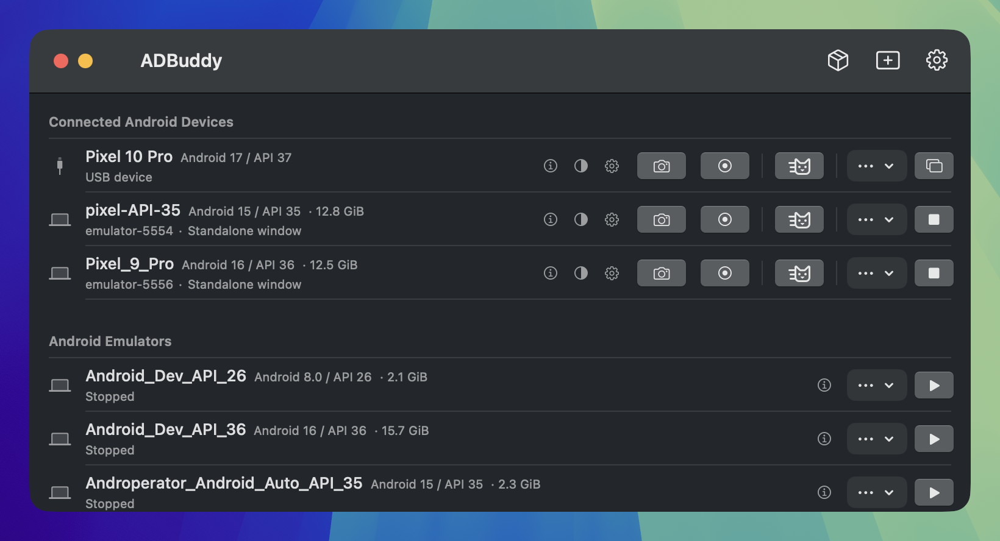
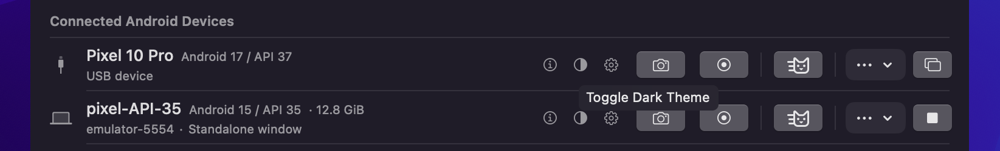
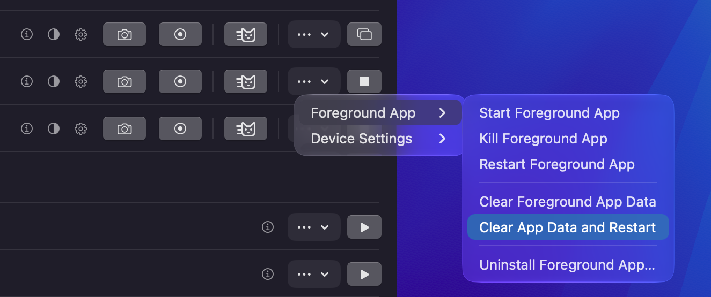
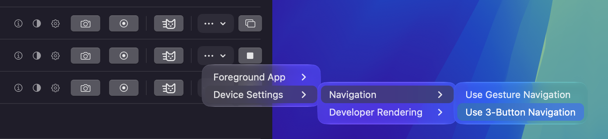
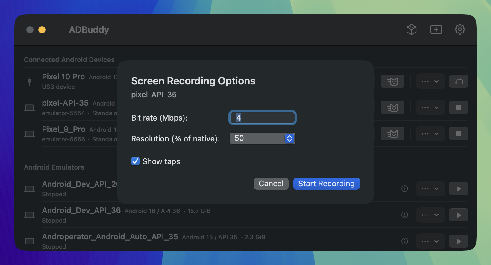
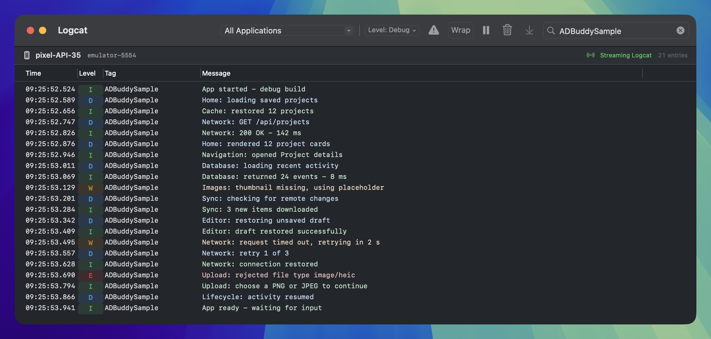
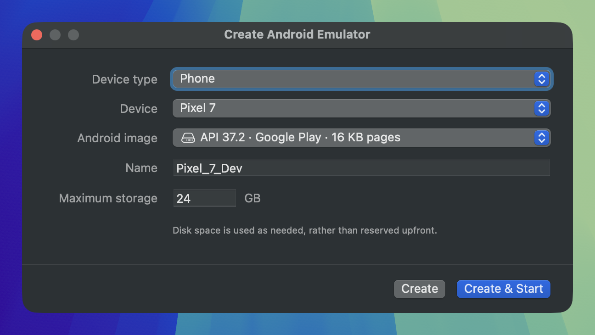
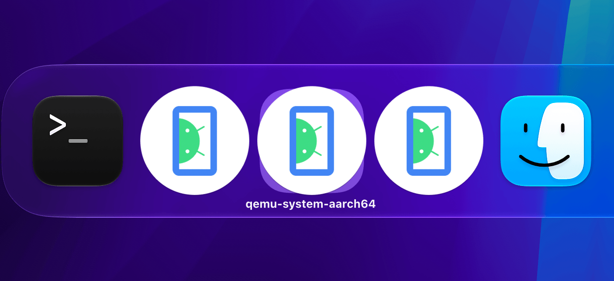

## ADBuddy (`adb`-buddy)

**Keep building. Leave Android Studio closed.**

Using Android Studio less these days? Maybe you've moved to Cursor. Maybe agents are writing your code.

But you still need to capture screenshots, record bugs, inspect Logcat, and create emulators. You want to check your UI in dark mode or switch to three-button navigation without digging through device settings.

ADBuddy fills that gap: a small, native macOS app for everyday Android device tasks. Leave Android Studio closed.

[**Download ADBuddy for macOS**](https://github.com/androperator/adbuddy/releases/latest) · [Getting started](#get-started) · [MCP setup](docs/mcp.md)

## Device and app controls



### Switch between light and dark mode



### Handy shortcuts a click away



### Toggle system navigation styles



## Advanced screenshots and screen recording



Record bugs as they happen, even while rotating a device or opening and closing a foldable. ADBuddy's dedicated recorder keeps capturing the whole sequence. Rotation stays in one clip; changes in screen size produce separate, numbered clips.

Choose your recording quality, make taps visible, and add device frames to screenshots and recordings. Record for up to three minutes per session. Captures are saved in one folder and copied to your clipboard, ready to share in a bug report or with your agent.

[More about capture support →](docs/recording-backend.md)

## Native macOS Logcat viewer



Open a Logcat window for each device. Filter by app or severity, search as you type, and jump straight to crashes and exceptions. Pause the stream, wrap long messages, and copy the lines you need.

*Sample messages shown. [Explore Logcat controls →](docs/logcat.md)*

## Emulator creation and management



Pick a phone, tablet, foldable, watch, TV, or another available device type. Choose an Android image, give it a name, and **Create & Start**.

Manage existing emulators alongside your connected devices. Start, stop, cold boot, or find their files without opening Android Studio.

*Emulator creation and deletion require Node.js 24+. [Setup details →](docs/usage.md#create-and-manage-emulators)*

## Pretty Adnroid emulator icons and names

Three identical icons named `qemu-system-aarch64`? Nah. Give each emulator a device icon and its AVD name in the Dock and app switcher.

**Without appearance tweaks:**



**With ADBuddy's optional appearance tweaks:**


## MCP tools for coding agents

ADBuddy includes a local MCP server so your agent can discover devices, start or stop emulators, and save screenshots and recordings. You and your agent use the same media folder and recording defaults.

[Connect your agent →](docs/mcp.md)

## Get started

1. [Download the latest release](https://github.com/androperator/adbuddy/releases/latest), unzip it, and move **ADBuddy.app** to Applications. Choose Apple silicon (`arm64`), Intel (`x86_64`), or the universal download for either.
2. Install the **Android SDK**, including ADB (`platform-tools`), if you haven't already. ADBuddy finds the standard `~/Library/Android/sdk` location automatically.
3. Connect a device with USB debugging enabled, or start an emulator. Open ADBuddy and get to work.

The Homebrew cask in [androperator/homebrew-tap](https://github.com/androperator/homebrew-tap) also installs the app once published:

```sh
brew install --cask androperator/tap/adbuddy
```

Update Homebrew installations with `brew upgrade --cask androperator/tap/adbuddy`.

Requires **macOS 14 or newer**. Emulator creation and deletion also need **Node.js 24+** and the SDK's emulator tools. [Setup, preferences, and workflow details →](docs/usage.md)

## Build and contribute

ADBuddy is written in Swift and SwiftUI. To build and launch it locally:

```sh
scripts/build_and_run.sh
```

See the [development guide](docs/development.md) for prerequisites and tests, [architecture](docs/architecture.md) for the code layout, and [product scope](docs/product-scope.md) for supported workflows and current limits. [Release notes](CHANGELOG.md) cover what's new.

## License

[Apache 2.0](LICENSE). Copyright © 2026 Action Launcher Pty Ltd.

Bundled components retain their own licenses. See the [recording backend notices](docs/recording-backend.md), [emulator helper provenance](vendor/emulator/README.md), and [emulator appearance tweaks attribution](vendor/emulator-tweaks/README.md).

Written by clankers. Engineered by [@chrismlacy](https://x.com/chrismlacy).
